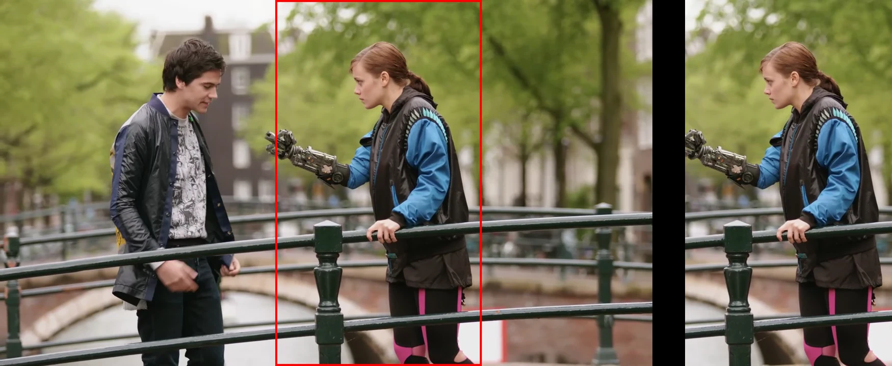

# Frametage-Encoder-Autoframer

`ftea` turns a landscape video into a vertical 9:16 clip that follows
the people in it, then encodes it as an HLS package of six variants, AV1
and H.264 at 1080p, 720p and 360p, that a phone's player moves between
as its connection gets faster or slower. It runs on your own computer
with an NVIDIA RTX 40-series or newer GPU, and you can watch the result
on your phone over your own Wi-Fi.



On the left, the original frame with the crop window `ftea` chose; on
the right, the vertical video it made.
Footage: [Tears of Steel](https://mango.blender.org) (2012) by the Blender Foundation, licensed under [CC BY 3.0](https://creativecommons.org/licenses/by/3.0/).

## Why this exists

Most film and video is shot in landscape, and most phones are held
upright. Cropping the middle out of a wide frame cuts people out of the
shot whenever they are not standing in the centre. `ftea` detects the
people in each shot, follows them with a smoothed virtual camera, and
keeps centred title cards readable, letterboxing a shot when its text is
wider than the vertical frame.

Mobile data is precious, so the encoder works scene by scene. Each scene
is test-encoded at two quality settings and scored with VMAF, and the
cheaper setting that reaches the quality target wins, so quiet scenes
spend fewer bits than busy ones.

`ftea` is a standalone fork of the encoding pipeline behind [Frametage](https://frametage.com),
a phone app for watching film clips. It is open source for three
reasons: to show how the technology behind the app works, to give
creators a free tool, and to find people who want to help improve it.

## What you get

For every video, `ftea` writes one folder you can watch, host or share:

- `master.m3u8` and six variants in 2-second segments: AV1 (10-bit) and
  H.264 (8-bit) at 1080×1920, 720×1280 and 360×640, each with the audio
  track
- `player.html`, a player that works offline, so the folder plays from
  any web server, including `ftea preview` on your own network
- `report.md` and `report.json`: the quality and bitrate of every variant
  and every scene
- a thumbnail, and for a reframed clip its crop track

These are the averages over 207 clips that the production pipeline
`ftea` was forked from encoded with the same six variants:

| Variant | Frame | Average video bitrate | Video per minute | Mean VMAF | VMAF target | Scene time at target |
| --- | --- | --- | --- | --- | --- | --- |
| AV1 1080p, 10-bit | 1080×1920 | 2,348 kbps | 17.61 MB | 95.25 | 93 | 86.0% |
| AV1 720p, 10-bit | 720×1280 | 1,255 kbps | 9.41 MB | 91.93 | 93 | 57.7% |
| AV1 360p, 10-bit | 360×640 | 332 kbps | 2.49 MB | 75.7 | 88 | 5.3% |
| H.264 1080p, 8-bit | 1080×1920 | 3,168 kbps | 23.76 MB | 94.38 | 93 | 79.5% |
| H.264 720p, 8-bit | 720×1280 | 2,036 kbps | 15.27 MB | 92.14 | 93 | 57.8% |
| H.264 360p, 8-bit | 360×640 | 522 kbps | 3.92 MB | 76.31 | 88 | 4.9% |

Read them with these in mind. The 207 clips come to 4.92 hours and
2,690 scenes, and they are not 207 different pieces of footage: one
source film appears twice, once as a pre-cropped cut and once as an
auto-reframed cut. 77 of the 207 clips are black and white, which needs
less bitrate than colour, so an average depends on that mix. Bitrates
and sizes are video only: the audio track comes on top. VMAF is
scored per scene at 1920×1080, and the 720p and 360p variants often miss
their targets, partly because each is scaled up to 1920×1080 before it
is scored. [How it works](docs/HOW-IT-WORKS.md#about-these-numbers)
explains the method and every caveat.

## Quick start

You need an NVIDIA RTX 40-series or newer GPU with a current driver,
Python 3.10 to 3.14, an FFmpeg build with NVENC and libvmaf, and about
12 GB of free disk. On Windows, use Git Bash, and clone into a short
folder such as `C:\ftea` (see [long paths](docs/PROCESS-GUIDE.md#long-paths-on-windows)).
The [process guide](docs/PROCESS-GUIDE.md#1-requirements) says where to
get each one.

```bash
cd /c                            # clones to C:\ftea; on Linux: cd ~
git clone https://github.com/arkevo/Frametage-Encoder-Autoframer.git ftea
cd ftea
bash install.sh --check          # checks this machine; installs nothing
bash install.sh                  # 5 to 15 minutes the first time
source .venv/Scripts/activate    # on Linux: source .venv/bin/activate
cp ~/Videos/my-clip.mp4 input/   # a landscape video of up to 10 minutes
ftea run
ftea preview my-clip             # prints an address to open on your phone
```

## Platforms

- **Windows 10 or 11, with Git Bash.** The production pipeline `ftea` was
  forked from runs on Windows.
- **Linux (x86_64).** `install.sh` is written for Ubuntu and Debian.
  `install.sh`, the test suite and a full encode ran on Ubuntu 24.04
  under WSL2, and `ftea preview` served the package it made to the same
  PC's browser. WSL2 uses the Windows NVIDIA driver, so a native Linux
  NVIDIA driver has not been verified yet.

## Documentation

- [Process guide](docs/PROCESS-GUIDE.md): requirements, installing,
  running, watching on a phone, hosting, settings and troubleshooting
- [How it works](docs/HOW-IT-WORKS.md): subject tracking, per-scene
  quality targets, why AV1 and H.264, and where the numbers come from
- [Roadmap](ROADMAP.md): what this release leaves out, and ideas for
  later
- [Contributing](CONTRIBUTING.md): running the tests, and the project's
  rules
- [Third-party notices](THIRD_PARTY_NOTICES.md): the software and models
  `ftea` uses, and their licenses

## License

`ftea` is licensed under the [Apache License 2.0](LICENSE).
