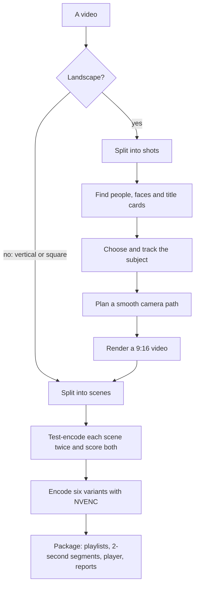

# Frametage-Encoder-Autoframer

`ftea` turns a landscape video into a vertical 9:16 clip that follows
the people in it, then encodes it as an HLS package of six variants, AV1
and H.264 at 1080p, 720p and 360p, that a phone's player moves between
as its connection gets faster or slower. It runs on your own computer
with an NVIDIA RTX 40-series or newer GPU, and you can watch the result
on your phone over your own Wi-Fi.


On the left, the original frame with the crop window `ftea` chose; on
the right, the vertical video it made.
Footage: [Tears of Steel](https://mango.blender.org) (2012) by the Blender Foundation, licensed under [CC BY 3.0](https://creativecommons.org/licenses/by/3.0/).

## Why this exists

Most film and video is shot in landscape, and most phones are held
upright. Cropping the middle out of a wide frame cuts people out of the
shot whenever they are not standing in the centre. `ftea` detects the
people in each shot, follows them with a smoothed virtual camera, and
keeps centred title cards readable, letterboxing a shot when its text is
wider than the vertical frame.

Mobile data is precious, so the encoder works scene by scene. Each scene
is test-encoded at two quality settings and scored with VMAF, and the
cheaper setting that reaches the quality target wins, so quiet scenes
spend fewer bits than busy ones.

`ftea` is a standalone fork of the encoding pipeline behind [Frametage](https://frametage.com),
a phone app for watching film clips. It is open source for three
reasons: to show how the technology behind the app works, to give
creators a free tool, and to find people who want to help improve it.

## How it works



The reframe stage runs as a separate program in its own Python
environment, `.venv-reframe`, because it needs CUDA builds of torch and
OpenCV, about 4.5 GB on Windows. The encoder needs only Python's standard
library and your FFmpeg, so `ftea run --no-reframe` works without the
reframe environment at all.

### Following the subject instead of cropping the centre

A 9:16 window cut from a 16:9 frame keeps 0.32 of its width: 608 of 1920
pixels. A fixed centre crop throws away whoever stands outside that
middle strip, and in films people often do. `ftea` moves the window to
follow them instead:

1. **Shots.** The video is split at its cuts (`REFRAME_SCENE_THRESHOLD`),
   so the camera starts fresh in each shot instead of panning across a
   cut.
2. **People and faces.** On every third frame of each shot
   (`REFRAME_STRIDE`), a person detector (torchvision's Faster R-CNN, on
   the GPU) and a face detector (OpenCV's YuNet) look for people. Each
   has its own confidence floor, 0.8 for people and 0.35 for faces,
   because the two score on different scales: in testing, person scores
   reached 0.9856 while face scores never passed 0.7462, and below about
   0.8 the person detector took lace and curtain textures, scoring around
   0.60, for people.
3. **Title cards.** On five frames of each shot, a text detector
   (PP-OCRv3) looks for a title card: at least two lines of text, each at
   least 4% of the frame's height, sharing one centre. Only that shape
   counts, so a sign or graffiti in the background does not. A title shot
   holds a still crop centred on the card, or is letterboxed, shown whole
   with black bars, when the card with a small margin each side is wider
   than the vertical frame.
4. **Choosing the subject.** Detections are linked into tracks across
   frames. Each track is scored on its size, with faces counting double
   (`REFRAME_FACE_WEIGHT`), and on how central, how confident and how
   lasting it is, so a two-frame flash cannot win. A new subject takes
   over only when it scores at least 20% higher for a full second, so the
   camera does not flick between two people.
5. **The camera path.** The virtual camera holds still while the subject
   stays inside the middle 90% of the window (`REFRAME_DEAD_ZONE`), then
   follows along a smoothed path (`REFRAME_SMOOTHING_HZ`) under a speed
   limit (`REFRAME_MAX_PAN_FRAC_PER_SEC`), the way a camera operator
   would, rather than a box locked to the subject.
6. **Nobody in the shot.** A shot with no one in it gets a still, centred
   crop. That is a normal result, not a failure. The detector can still
   report a subject in such a shot, and the crop then follows that
   instead; `--debug-video` shows when it happens.
7. **Rendering.** The window's position is fed to FFmpeg frame by frame,
   and the vertical video is rendered once, at high quality (HEVC on
   NVENC at CQ 10), as the encoder's source.

To see what the camera did, run
`ftea reframe <video> --debug-video`: `debug.mp4` shows the original with
the crop window as a red rectangle beside the result (see
[the process guide](docs/PROCESS-GUIDE.md#making-only-a-vertical-video-with-ftea-reframe)).

### Encoding scene by scene to a quality target

A fixed bitrate has to be big enough for the hardest clip you will ever
encode, so it spends too much on every easier one. `ftea` aims at a
quality level instead, and lets the bitrate follow the content:

1. **Scenes.** The clip is split at scene changes. Scenes shorter than a
   second merge into a neighbour, and scenes longer than 10 seconds are
   split.
2. **Two test encodes per scene and variant.** Each scene is encoded at
   the variant's starting quality setting, its CQ, minus and plus 4 (for
   AV1 1080p, CQ 26 and CQ 34), and both results are scored with VMAF.
   The encoder keeps the one closest to the variant's VMAF target that
   still reaches it, or the higher-quality one if neither does. A lower
   CQ means higher quality and more data.
3. **Final encode.** Each scene is encoded with NVENC at its chosen
   setting, under a bitrate cap, and the scenes are joined.

This is a choice between two settings rather than a search, which keeps
it fast: NVENC encodes in hardware, and each scene is tried only twice
per variant.

The numbers, the codec choices and how quality is measured are in
[How it works](docs/HOW-IT-WORKS.md).

## What you get

For every video, `ftea` writes one folder you can watch, host or share:

- `master.m3u8` and six variants in 2-second segments: AV1 (10-bit) and
  H.264 (8-bit) at 1080×1920, 720×1280 and 360×640, each with the audio
  track
- `player.html`, a player that works offline, so the folder plays from
  any web server, including `ftea preview` on your own network
- `report.md` and `report.json`: the quality and bitrate of every variant
  and every scene
- a thumbnail, and for a reframed clip its crop track

These are the averages over 207 clips that the production pipeline
`ftea` was forked from encoded with the same six variants:

| Variant | Frame | Average video bitrate | Video per minute | Mean VMAF | VMAF target | Scene time at target |
| --- | --- | --- | --- | --- | --- | --- |
| AV1 1080p, 10-bit | 1080×1920 | 2,348 kbps | 17.61 MB | 95.25 | 93 | 86.0% |
| AV1 720p, 10-bit | 720×1280 | 1,255 kbps | 9.41 MB | 91.93 | 93 | 57.7% |
| AV1 360p, 10-bit | 360×640 | 332 kbps | 2.49 MB | 75.7 | 88 | 5.3% |
| H.264 1080p, 8-bit | 1080×1920 | 3,168 kbps | 23.76 MB | 94.38 | 93 | 79.5% |
| H.264 720p, 8-bit | 720×1280 | 2,036 kbps | 15.27 MB | 92.14 | 93 | 57.8% |
| H.264 360p, 8-bit | 360×640 | 522 kbps | 3.92 MB | 76.31 | 88 | 4.9% |

Read them with these in mind. The 207 clips come to 4.92 hours and
2,690 scenes, and they are not 207 different pieces of footage: one
source film appears twice, once as a pre-cropped cut and once as an
auto-reframed cut. 77 of the 207 clips are black and white, which needs
less bitrate than colour, so an average depends on that mix. Bitrates
and sizes are video only: the audio track comes on top. VMAF is
scored per scene at 1920×1080, and the 720p and 360p variants often miss
their targets, partly because each is scaled up to 1920×1080 before it
is scored. [How it works](docs/HOW-IT-WORKS.md#about-these-numbers)
explains the method and every caveat.

## Quick start

You need an NVIDIA RTX 40-series or newer GPU with a current driver,
Python 3.10 to 3.14, an FFmpeg build with NVENC and libvmaf, and about
12 GB of free disk. On Windows, use Git Bash, and clone into a short
folder such as `C:\ftea` (see [long paths](docs/PROCESS-GUIDE.md#long-paths-on-windows)).
The [process guide](docs/PROCESS-GUIDE.md#1-requirements) says where to
get each one.

```bash
cd /c                            # clones to C:\ftea; on Linux: cd ~
git clone https://github.com/arkevo/Frametage-Encoder-Autoframer.git ftea
cd ftea
bash install.sh --check          # checks this machine; installs nothing
bash install.sh                  # 5 to 15 minutes the first time
source .venv/Scripts/activate    # on Linux: source .venv/bin/activate
cp ~/Videos/my-clip.mp4 input/   # a landscape video of up to 10 minutes
ftea run
ftea preview my-clip             # prints an address to open on your phone
```

## Platforms

- **Windows 10 or 11, with Git Bash.** The production pipeline `ftea` was
  forked from runs on Windows.
- **Linux (x86_64).** `install.sh` is written for Ubuntu and Debian.
  `install.sh`, the test suite and a full encode ran on Ubuntu 24.04
  under WSL2, and `ftea preview` served the package it made to the same
  PC's browser. WSL2 uses the Windows NVIDIA driver, so a native Linux
  NVIDIA driver has not been verified yet.

## Documentation

- [Process guide](docs/PROCESS-GUIDE.md): requirements, installing,
  running, watching on a phone, hosting, settings and troubleshooting
- [How it works](docs/HOW-IT-WORKS.md): subject tracking, per-scene
  quality targets, why AV1 and H.264, and where the numbers come from
- [Roadmap](ROADMAP.md): what this release leaves out, and ideas for
  later
- [Contributing](CONTRIBUTING.md): running the tests, and the project's
  rules
- [Third-party notices](THIRD_PARTY_NOTICES.md): the software and models
  `ftea` uses, and their licenses

## License

`ftea` is licensed under the [Apache License 2.0](LICENSE).
