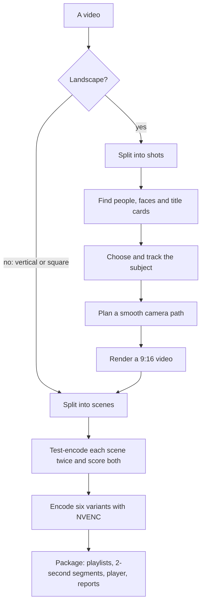
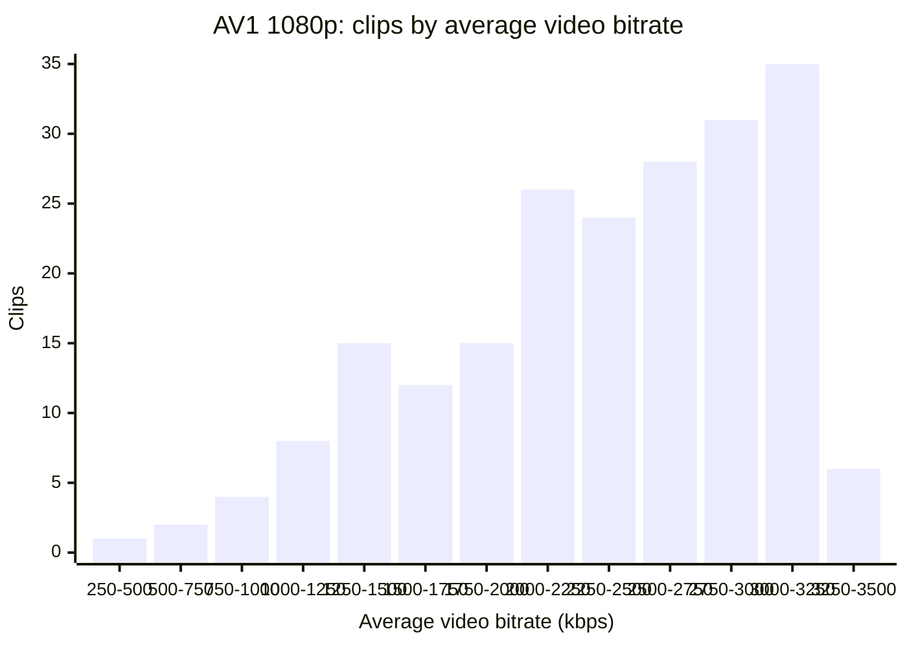

# How ftea works

`ftea` does two jobs. It turns a landscape video into a vertical one by
following the people in it, and it encodes the result so that a phone
gets as much picture quality as its connection allows for as little data
as possible. This page explains how each part works, why it is built
that way, and what the numbers in the [README](../README.md) mean.

- [The pipeline at a glance](#the-pipeline-at-a-glance)
- [Following the subject instead of cropping the centre](#following-the-subject-instead-of-cropping-the-centre)
- [Encoding scene by scene to a quality target](#encoding-scene-by-scene-to-a-quality-target)
- [Why AV1 and H.264](#why-av1-and-h264)
- [Why 2-second segments](#why-2-second-segments)
- [How quality is measured](#how-quality-is-measured)
- [About these numbers](#about-these-numbers)

## The pipeline at a glance

The reframe stage runs as a separate program in its own Python
environment, `.venv-reframe`, because it needs CUDA builds of torch and
OpenCV, about 4.5 GB on Windows. The encoder needs only Python's standard
library and your FFmpeg, so `ftea run --no-reframe` works without the
reframe environment at all.

## Following the subject instead of cropping the centre

A 9:16 window cut from a 16:9 frame keeps 0.32 of its width: 608 of 1920
pixels. A fixed centre crop throws away whoever stands outside that
middle strip, and in films people often do. `ftea` moves the window to
follow them instead:

1. **Shots.** The video is split at its cuts (`REFRAME_SCENE_THRESHOLD`),
   so the camera starts fresh in each shot instead of panning across a
   cut.
2. **People and faces.** On every third frame of each shot
   (`REFRAME_STRIDE`), a person detector (torchvision's Faster R-CNN, on
   the GPU) and a face detector (OpenCV's YuNet) look for people. Each
   has its own confidence floor, 0.8 for people and 0.35 for faces,
   because the two score on different scales: in testing, person scores
   reached 0.9856 while face scores never passed 0.7462, and below about
   0.8 the person detector took lace and curtain textures, scoring around
   0.60, for people.
3. **Title cards.** On five frames of each shot, a text detector
   (PP-OCRv3) looks for a title card: at least two lines of text, each at
   least 4% of the frame's height, sharing one centre. Only that shape
   counts, so a sign or graffiti in the background does not. A title shot
   holds a still crop centred on the card, or is letterboxed, shown whole
   with black bars, when the card with a small margin each side is wider
   than the vertical frame.
4. **Choosing the subject.** Detections are linked into tracks across
   frames. Each track is scored on its size, with faces counting double
   (`REFRAME_FACE_WEIGHT`), and on how central, how confident and how
   lasting it is, so a two-frame flash cannot win. A new subject takes
   over only when it scores at least 20% higher for a full second, so the
   camera does not flick between two people.
5. **The camera path.** The virtual camera holds still while the subject
   stays inside the middle 90% of the window (`REFRAME_DEAD_ZONE`), then
   follows along a smoothed path (`REFRAME_SMOOTHING_HZ`) under a speed
   limit (`REFRAME_MAX_PAN_FRAC_PER_SEC`), the way a camera operator
   would, rather than a box locked to the subject.
6. **Nobody in the shot.** A shot with no one in it gets a still, centred
   crop. That is a normal result, not a failure. The detector can still
   report a subject in such a shot, and the crop then follows that
   instead; `--debug-video` shows when it happens.
7. **Rendering.** The window's position is fed to FFmpeg frame by frame,
   and the vertical video is rendered once, at high quality (HEVC on
   NVENC at CQ 10), as the encoder's source.

To see what the camera did, run
`ftea reframe <video> --debug-video`: `debug.mp4` shows the original with
the crop window as a red rectangle beside the result (see
[the process guide](PROCESS-GUIDE.md#making-only-a-vertical-video-with-ftea-reframe)).

## Encoding scene by scene to a quality target

A fixed bitrate has to be big enough for the hardest clip you will ever
encode, so it spends too much on every easier one. `ftea` aims at a
quality level instead, and lets the bitrate follow the content:

1. **Scenes.** The clip is split at scene changes. Scenes shorter than a
   second merge into a neighbour, and scenes longer than 10 seconds are
   split.
2. **Two test encodes per scene and variant.** Each scene is encoded at
   the variant's starting quality setting, its CQ, minus and plus 4 (for
   AV1 1080p, CQ 26 and CQ 34), and both results are scored with VMAF.
   The encoder keeps the one closest to the variant's VMAF target that
   still reaches it, or the higher-quality one if neither does. A lower
   CQ means higher quality and more data.
3. **Final encode.** Each scene is encoded with NVENC at its chosen
   setting, under a bitrate cap, and the scenes are joined.

This is a choice between two settings rather than a search, which keeps
it fast: NVENC encodes in hardware, and each scene is tried only twice
per variant.

### What it did across 207 clips

These numbers come from the production pipeline `ftea` was forked from;
[About these numbers](#about-these-numbers) describes the clips. The AV1
1080p variant used both settings within the same clip in 81.2% of clips,
and the cheaper one for 65.9% of all scenes. The result is a wide spread
of bitrates at a narrow spread of quality: the middle 80% of clips
averaged between 1,373 and 3,134 kbps, a 2.28× range, while their mean
VMAF stayed between 92.51 and 97.9.

### AV1 1080p: clips by average video bitrate

The same data as a table:

| Bitrate (kbps) | Clips |
| --- | --- |
| 250 to 500 | 1 |
| 500 to 750 | 2 |
| 750 to 1000 | 4 |
| 1000 to 1250 | 8 |
| 1250 to 1500 | 15 |
| 1500 to 1750 | 12 |
| 1750 to 2000 | 15 |
| 2000 to 2250 | 26 |
| 2250 to 2500 | 24 |
| 2500 to 2750 | 28 |
| 2750 to 3000 | 31 |
| 3000 to 3250 | 35 |
| 3250 to 3500 | 6 |

The AV1 1080p bitrate cap is `3000k`, and the chart's top two bars are
clips that averaged above it.

Black-and-white footage needs fewer bits than colour: at AV1 1080p, the
colour clips averaged 2,579 kbps and the black-and-white ones 1,960 kbps
(77 of the 207 clips are black and white).

How often each variant took the cheaper setting:

| Variant | Scenes on the cheaper setting | Clips that used both settings |
| --- | --- | --- |
| AV1 1080p | 65.9% | 81.2% |
| AV1 720p | 23.8% | 67.1% |
| AV1 360p | 1.0% | 6.8% |
| H.264 1080p | 56.8% | 82.1% |
| H.264 720p | 11.3% | 52.2% |
| H.264 360p | 0.9% | 5.8% |

The small variants almost always needed the higher-quality setting, and
mostly still missed their targets;
[How quality is measured](#how-quality-is-measured) explains why.

No fixed-bitrate encode of these clips was made, so this page claims no
saving against one. What the chart does show is the problem with a
fixed rate: one rate for all of these clips would have to sit near the
top of that range to serve the hardest ones.

## Why AV1 and H.264

Every clip is encoded twice, once in each codec, at three sizes. Across
the same clips, AV1 needed 26% to 38% less video data than H.264 at
similar scores, slightly higher at 1080p and slightly lower at 720p and
360p:

| Size | AV1 | H.264 | AV1 uses |
| --- | --- | --- | --- |
| 1080p | 2,348 kbps (VMAF 95.25) | 3,168 kbps (VMAF 94.38) | 26% less |
| 720p | 1,255 kbps (VMAF 91.93) | 2,036 kbps (VMAF 92.14) | 38% less |
| 360p | 332 kbps (VMAF 75.7) | 522 kbps (VMAF 76.31) | 36% less |

At 1080p that is 17.61 MB of video per minute instead of 23.76 MB. But
AV1 only helps a phone that can decode it in hardware: decoding it in
software costs battery and can stutter. H.264 plays on effectively every
phone, so `ftea` ships both, and the player is designed to offer each
browser only the variants it can decode. AV1 is encoded with 10-bit
colour, which shows less banding in smooth gradients such as skies;
H.264 uses 8-bit High profile, which every phone decodes. HEVC, which
many phones without AV1 decode in hardware, is on the
[roadmap](../ROADMAP.md).

`master.m3u8` labels each variant with a `CODECS` string that describes
it exactly as encoded: `av01.0.08M.10`, `av01.0.05M.10` and
`av01.0.01M.10` for the AV1 variants (Main profile, 10-bit, levels 4.0,
3.1 and 2.1), and `avc1.640028` for every H.264 variant (High profile,
level 4.0), each followed by `mp4a.40.2`, AAC audio, when the clip has
sound.

## Why 2-second segments

Each variant is cut into 2-second segments (`HLS_SEGMENT_SEC`), and every
segment starts with a keyframe. A player can only switch variants at a
segment boundary, and it needs a whole segment before the picture
starts. Short segments therefore mean a quick start and a quick step
down when the connection weakens, which matters for short clips watched
on a phone. The cost is more keyframes, which take more bits than other
frames, and more requests to the server. For clips of a few minutes,
`ftea` takes that trade; raise `HLS_SEGMENT_SEC` for long-form video.

The segments are fragmented MP4 (fMP4), which carries both AV1 and
H.264 and which current players read directly.

## How quality is measured

VMAF, from Netflix, compares a video with its source frame by frame and
scores it from 0 to 100; it was built to predict how people rate picture
quality. `ftea` scores every test encode of every scene with FFmpeg's
`libvmaf` filter and its `vmaf_v0.6.1` model, after scaling both the
encode and its source to 1920×1080. That has three consequences:

- **Vertical clips are scored on a squeezed picture.** Both sides are
  squeezed to landscape shape in the same way, so the comparison is fair,
  but the scores are not measured at the clip's own 1080×1920. This keeps
  the numbers comparable with the production pipeline's.
- **Small variants are marked down hard.** A 360p variant is scaled up
  to 1920×1080 before it is scored, as if it were watched on a large
  screen. At 360p, 99.0% of AV1 scenes and 99.1% of H.264 scenes used
  the higher-quality of the two settings, yet only 5.3% and 4.9% of their
  scene time reached the target of 88. On a phone, a 360p variant is
  shown far smaller. Scoring that reflects phone viewing is on the
  [roadmap](../ROADMAP.md).
- **A reframed clip is scored against the reframed video**, not the
  original landscape file, so VMAF measures the encode, not the
  reframing.

`VMAF_FLOOR` (91) applies to every variant, including the 360p ones whose
target is 88, so with these settings almost every clip reports status
`warning`. In the production reports below, all 207 did, and none
failed.

## About these numbers

Read the numbers on this page and in the README with these in mind:

- They come from 207 clips that the production pipeline `ftea` was
  forked from encoded with the same six variants: 4.92 hours of video in
  2,690 scenes. They are not 207 different pieces of footage: one source
  film appears twice, once as a pre-cropped cut and once as an
  auto-reframed cut. 77 of the 207 clips are black and white, which needs
  less bitrate. 33 clips were reframed, all from 1920×1080 landscape
  sources; the other 174 were already vertical.
- All 207 clips report status `warning` (see above). None failed.
- **Bitrates are video only.** Each clip's bitrate is the one ffprobe
  reports for its joined, video-only file; the AAC audio is added when the
  clip is packaged. Averages are weighted by clip length: total video bits
  over total seconds.
- **Mean VMAF** is each clip's mean, weighted by clip length like the
  bitrate. VMAF is scored per scene, on the encode at the chosen setting,
  before the scenes are joined and packaged, as described above.
- **Scene time at target** is the share of scene time whose chosen
  encode scored at or above the variant's target. No variant reached its
  target everywhere, and the 360p variants almost never did, so none is
  described here as meeting its target.
- Clips encoded on a retry may have used a target lowered by
  `RETRY_VMAF_RELAXATION`. The reports do not record this, so the share
  at target is measured against the normal targets of 93, 93 and 88.
- The reports come from several versions of the production pipeline and
  do not record which. The targets above were the same throughout, as
  its operator confirmed. Timings are quoted only from the 33 reframed
  clips, the most recent version, measured on an NVIDIA GeForce RTX 5080
  as its operator stated.
- No figure here compares against a fixed-bitrate encode. None was
  measured.
- The reports and the tool that aggregated them are not part of this
  repository. Turning your own `report.json` files into the same tables
  is on the [roadmap](../ROADMAP.md).
